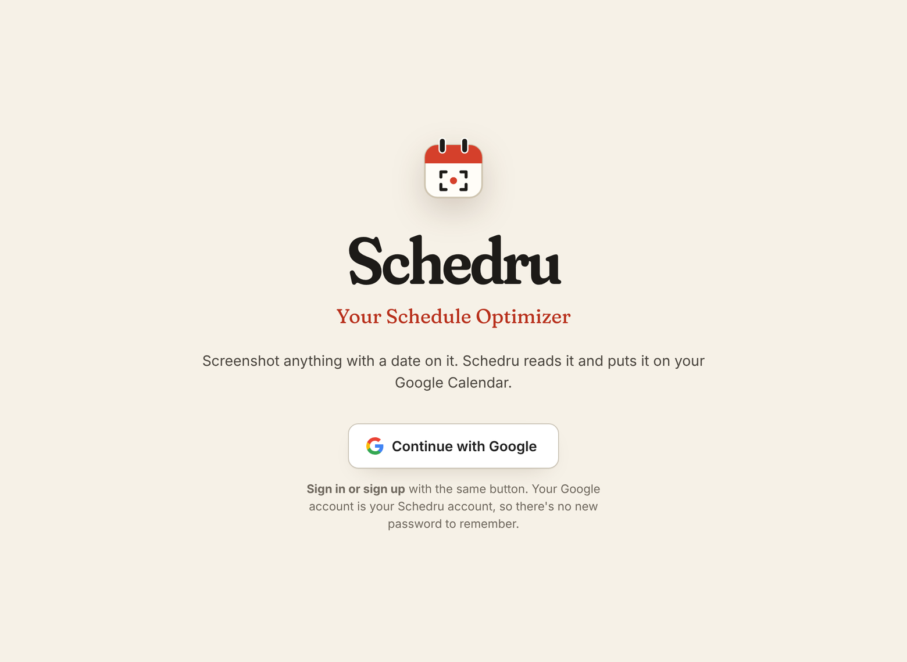
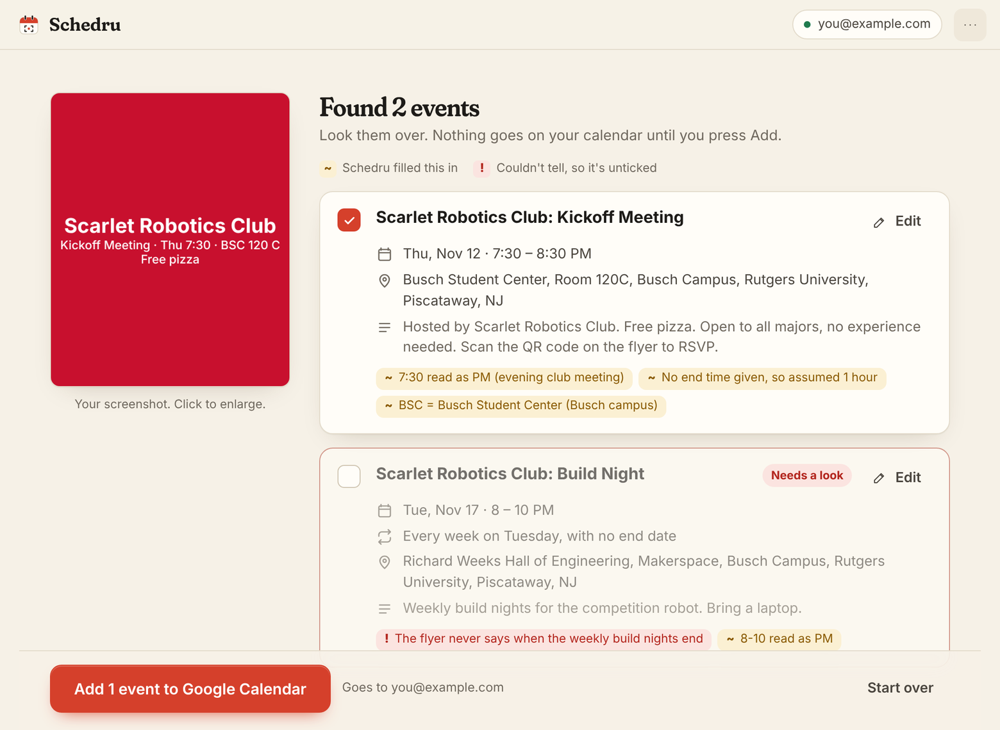

# Schedru

**Your Schedule Optimizer.** Screenshot anything with a date on it — a club
flyer, a syllabus, an email, a group chat — and Schedru reads it, fills in
what you'd want to know, and puts it on your Google Calendar once you say so.



## How it works

1. **Capture.** Press **⌘⇧2** from any app and drag over what you want, or
   press **Capture** in the window. You can also drop or paste (**⌘V**) a
   screenshot or photo you already have.
2. **Check.** Schedru shows each event it found, with the time, place,
   address and notes filled in. Edit anything it got wrong.
3. **Add.** One press and the ticked events are on your Google Calendar.



**Nothing is added until you press Add.** Events it was sure about are
ticked for you. Anything it had to fill in itself is marked **~** so you can
check it; anything it couldn't work out is marked **!** and left unticked.

The app opens with a 38-second tutorial that shows all of this
(`syllabus_cal/app/web/media/tutorial.mp4`). You can replay it from the
**⋯** menu.

## Get the app (Mac)

1. **Download it.** On this repository's **Actions** tab, open the newest
   **Mac** run with a green tick, scroll to **Artifacts**, and download
   **Schedru-AppleSilicon** (Macs with an M-series chip) or **Schedru-Intel**.
   Not sure which? Apple menu → About This Mac: "Chip: Apple M…" means Apple
   Silicon.
2. **Install it.** Open the download, open `Schedru-….dmg`, and drag
   **Schedru** onto **Applications**.
3. **Open it the first time.** macOS will refuse, saying it can't verify the
   app — that's what it says about every app that hasn't paid Apple for a
   developer certificate. Open **System Settings → Privacy & Security**,
   scroll down to *"Schedru" was blocked…*, press **Open Anyway**, and
   confirm. You only do this once.
4. **Follow the window.** It asks for two things, once each (see the next
   section), plays the tutorial, and then you're at the capture screen.
5. **The first capture** makes macOS ask for **Screen Recording**
   permission. Schedru's window explains the three clicks. Until you've done
   that, dropping and pasting screenshots still works.

Closing the window leaves Schedru running in the Dock so **⌘⇧2** keeps
working; click the Dock icon to bring the window back, **⌘Q** to quit.

## Two things only you can supply

Both are tied to your own accounts, so nobody can create them for you. The
app asks for each in its own window; neither needs a terminal.

1. **A Claude API key**, from
   [console.anthropic.com](https://console.anthropic.com/settings/keys).
   This is what reads the screenshots. Anthropic bills it per use, separately
   from any Claude subscription: about **1–2 cents per screenshot**. Paste it
   into the app when asked; the app checks it works before saving it.
2. **A Google credentials file**, from Google Cloud. This is what lets *your
   copy* of Schedru touch *your* calendar. [`SETUP.md`](./SETUP.md) walks
   through making one from zero (about ten minutes, free, once). If you set
   up an earlier version, you already have it: it's the `credentials.json` in
   that folder. Drop it onto the app when asked.

After that, **Continue with Google** is all there is to signing in — it's
the same button whether it's your first time or your hundredth. Google signs
personal apps out about once a week; when that happens Schedru says so and
the same button signs you back in.

## What it fills in

Each event is written to make sense on its own when you look at it later:

- **Where**, findable in Maps: abbreviations expanded and an address added,
  e.g. `BSC 120 C` → `Busch Student Center, Room 120C, Busch Campus, Rutgers
  University, Piscataway, NJ`. It assumes Rutgers–New Brunswick unless the
  image says otherwise (`HOME_CONTEXT` in
  `syllabus_cal/prompts/extract_events.py`).
- **When**: AM/PM, a missing end time, or a missing year are filled in from
  context — a bare `7:30` on a club flyer is the evening.
- **What to know**: who's hosting, acronyms spelled out, cost, free food,
  what to bring, RSVP links, a QR code to scan — whatever the image shows.
- **A title that stands alone**: `Rutgers AI Club: Weekly Meeting`, not
  `Weekly Meeting`.
- **Repeats** as one repeating event (`Tue/Thu 9:50` is one event, not thirty).

Everything it filled in rather than read is also listed in the event's
description on your calendar, so a wrong guess is easy to spot later.

## Running from this folder instead

You can run the same app straight from this folder, on any system with
**Python 3.11 or newer** ([python.org/downloads](https://www.python.org/downloads/)):

- **macOS:** double-click `start.command`. (The first time, macOS blocks it
  the same way it blocks the app: System Settings → Privacy & Security →
  **Open Anyway**.) The first run installs what it needs, then the Schedru
  window opens. A Terminal window stays open behind it; closing that closes
  Schedru.
- **Windows:** double-click `start.bat`. Schedru opens as a tab in your
  browser. Everything works there except capturing from the screen — drop,
  paste or choose a screenshot instead. (A proper Windows app is not built
  yet.)

Run this way, your key and Google files live in this folder, exactly where
earlier versions kept them, so an existing setup carries straight over.

The original terminal version is still here:

```
bash start.command --terminal                             # the old guided flow
python -m syllabus_cal parse ./screenshot.png             # one image
python -m syllabus_cal parse ./screenshot.png --dry-run   # read only, never writes
python -m syllabus_cal auth --test-event                  # sign in + one throwaway event
```

## Where your things are kept

| | The Mac app | Run from this folder |
|---|---|---|
| Claude key (`.env`) | `~/Library/Application Support/Schedru/` | this folder |
| Google files (`credentials.json`, `token.json`) | same | this folder |
| If something goes wrong (`schedru.log`) | same | printed in the terminal |

The key and the Google sign-in are saved readable only by you, are never
committed (see `.gitignore`), and go nowhere except Anthropic and Google
respectively. Screenshots are sent to Anthropic to be read and are deleted
from this computer when you finish with them.

Every event Schedru creates is tagged
`extendedProperties.private.created_by = "syllabus_cal"`, so they can be
found and bulk-deleted later without touching anything else.

## What's verified, and what isn't

**Checked on real Macs, automatically, on every change** (GitHub's macOS
machines; `tools/mac_e2e.py` posts real keyboard and mouse events):

- The packaged `Schedru.app` builds, is recognised by macOS as "Schedru",
  and carries everything the real engine needs (`--self-check`).
- The window opens, the tutorial video plays, setup can be clicked through.
- **⌘⇧2 from another app** starts a capture; dragging a region produces
  exactly that region; the result comes back in the window, in front.
- The **Capture** button hides the window first and brings it back after.
- **Esc** cancels cleanly. **⌘V** reads a pasted image.
- Closing the window keeps the shortcut working; the Dock icon reopens it;
  **⌘Q** quits.
- Opened like a double-click *without* Screen Recording permission, it asks
  for permission instead of taking a useless screenshot.

Those runs use a stand-in for Claude and Google, so they need no accounts.

**Checked with unit tests** (about 400): the rules for what gets written and
when, sign-in and every way it fails, edits, the local server's security
checks, image handling (HEIC, rotated photos), repeating events across
daylight-saving changes, and first-run setup.

**Checked against the real Claude API** only when the *Real API check*
workflow is run by hand (it costs a few cents): three sample screenshots
are read for real and the results compared with what a person would expect.

**Not yet checked by anything but you:**

- **Signing in to a real Google account and an event landing on a real
  calendar.** That needs your account. The code path is the same one the
  terminal version uses, but the first real sign-in is the first real test.
- **The first-open steps on your Mac** (the "Open Anyway" prompt, the Screen
  Recording switch). They can't be automated; the instructions above follow
  Apple's documented behaviour.
- **Dragging a file in from Finder.** The drop handling is tested, but not a
  physical drag. Paste and *Choose a file…* are tested end to end.
- **macOS versions other than 26 (Apple Silicon) and 15 (Intel).** The app
  is built to run on macOS 11 and later.

## Development

```
pip install -r requirements.txt pytest
python -m pytest tests/ -q              # unit tests
python -m syllabus_cal.app --demo       # the app with a stand-in engine
python -m syllabus_cal.app --self-check # is everything it needs present?
node tools/ui_shots.mjs                 # walk every screen in a browser, photograph each
node tools/make_tutorial.mjs            # re-render the tutorial video
python tools/mac_e2e.py --source        # (Mac only) drive the real window
pyinstaller packaging/Schedru.spec      # (Mac only) build dist/Schedru.app
```

How it fits together: `syllabus_cal/` is the engine (Claude vision → events →
Google Calendar). `syllabus_cal/app/` puts a window on it: `service.py` is
what the app can do, `server.py` offers that to the page over a local,
token-guarded connection, `web/` is the page, and `shell.py` opens it in a
native window with the global shortcut. If Claude reads something wrong, the
fix is almost always in `syllabus_cal/prompts/extract_events.py`.
